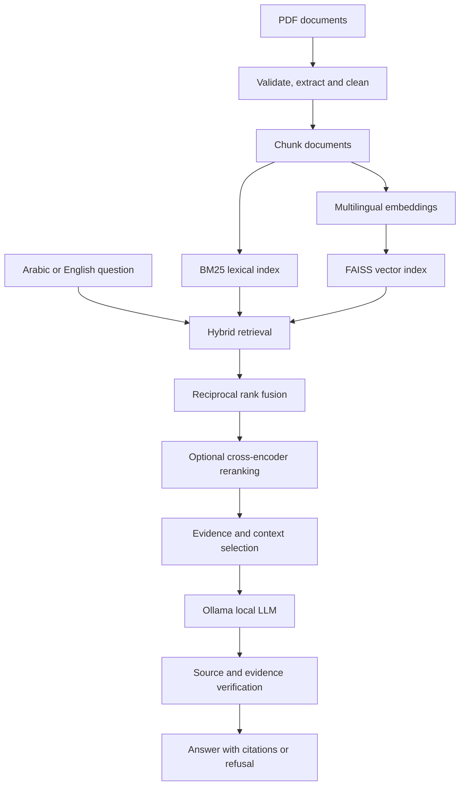

<div align="center">

# Offline Multilingual RAG System

**Arabic & English document question answering with local LLMs**

Hybrid Retrieval · Evidence Verification · Benchmarking · Streamlit · Docker

</div>

> **Project status:** Research / engineering prototype. Local inference is available after initial model downloads; benchmark results below are specific to the project's evaluation datasets and CPU environment, not general accuracy guarantees.

## Overview

A locally deployable Retrieval-Augmented Generation (RAG) application for asking questions over PDF collections in Arabic and English. Its modular pipeline processes documents, indexes multilingual embeddings, combines dense and lexical retrieval, optionally reranks passages, and generates evidence-grounded answers through Ollama. It includes document management, persistent chat history, evaluations, and a Streamlit interface.

## Architecture



**Default configuration** (`configs/config.yaml`): `intfloat/multilingual-e5-base` embeddings, FAISS + BM25 retrieval, `BAAI/bge-reranker-v2-m3` reranking, and `gemma3:4b` via Ollama. Reranking carries substantial CPU latency and should be evaluated against responsiveness needs.

## Highlights

- Multilingual PDF extraction and recursive chunking, retaining document metadata.
- Hybrid semantic + lexical retrieval with reciprocal rank fusion.
- Optional cross-encoder reranking and evidence-grounded generation.
- Citation checks, numeric evidence checks, and refusal handling for insufficient evidence.
- Local Ollama models and a Streamlit UI with document management and chat history.
- Evaluation scripts for embeddings, retrieval, and LLM output; automated unit tests.

## Evaluation snapshots

These results were recorded in this project's reports, on specific local datasets. They should **not** be interpreted as benchmark performance on unseen documents.

| Evaluation | Setup | Reported result |
|---|---|---|
| Embedding comparison | One Arabic PDF, 4 labeled questions | `multilingual-e5-base` Recall@3: **4/4** |
| Initial retrieval study | One PDF, 10 labeled questions | Hybrid RRF Recall@3: **1.00**, MRR: **0.85**, average latency: **206 ms** |
| Reranking comparison | Same 10-query retrieval study | MRR: **0.90**, average latency: **18.48 s** |
| LLM model comparison | 8 Ollama models; 70 bilingual questions (35 Arabic, 35 English) | `gemma3:4b`: **80.0%** original heuristic accuracy; **28.6 s** mean latency |
| LLM stricter rescore | 68 retained answers per compared model | `gemma3:4b`: **77.9%** primary score, **61.8%** strict score |

The re-score changes numeric matching and excludes an unanswerable item; it is **not directly interchangeable** with the initial accuracy measure. Model scoring uses automated comparison signals. Consult [embedding results](docs/benchmarks/embedding_benchmark_results.md), [retrieval results](docs/benchmarks/retrieval_benchmark_results.md), and [LLM results](docs/benchmarks/llm_benchmark_results.md) for limitations and methodology.

**Current automated test check (local):** 233 unit tests passed in 11.40 s (Python 3.12.3, Ubuntu). This does not establish production readiness or end-to-end performance across environments.

---

## Requirements

- Python 3.11 or newer
- Ollama with `gemma3:4b` pulled
- Local model downloads require network access on first use

## Native setup

```bash
python3 -m venv .venv
.venv/bin/python -m pip install --index-url https://download.pytorch.org/whl/cpu "torch>=2.2"
.venv/bin/python -m pip install -e ".[dev,reports,ui]"
ollama pull gemma3:4b
.venv/bin/streamlit run src/rag_system/ui/app.py
```

On Windows, use `packaging/windows/install.ps1` and `packaging/windows/start.ps1`. Linux install and start scripts are under `packaging/linux/`.

The UI sidebar supports PDF upload, indexing, and document removal. Add PDFs through the app; uploaded files, chat history, and indexes are stored beneath `data/`.

## Docker

```bash
docker compose up --build -d
docker compose exec ollama ollama pull gemma3:4b
```

Open `http://localhost:8501`. Compose keeps Ollama and Hugging Face caches in named volumes, mounts `./data` for persistent application data, and binds the UI to localhost.

## Evaluation and reports

```bash
python scripts/evaluate_rag.py --langs ar --ids 1,2
python scripts/build_benchmark_pdf.py data/evaluation/latest.json
```

The PDF command uses the optional `reports` dependency. Evaluation invokes the configured local generation and faithfulness models.

## Project structure

- `src/rag_system/`: ingestion, chunking, embeddings, retrieval, generation, verification, chat, evaluation, and UI
- `configs/config.yaml`: project defaults
- `docs/phases/`: implementation notes for Phases 10–20
- `tests/`: unit, integration, and performance test suites

Deployment environment variables: `RAG_PROJECT_ROOT` selects the config/data root, `RAG_OLLAMA_BASE_URL` overrides the Ollama endpoint, and `RAG_LLM_MODEL` selects the local generation model.

## Status

✅ Phases 0–20 implemented. See `docs/phases/` for phase notes.


## Fixed 35-question bilingual benchmark

From the project root, using the existing local models and indexes:

```bash
venv/bin/python scripts/benchmark_mof35.py
```

This freshly runs 35 fixed workbook questions in Arabic and English (70 cases),
using hybrid retrieval followed by reranking with top 5 results. The 35 questions
refer to 7 of the 8 indexed PDFs. Missing required sources or incomplete results
fail the run; the denominator is never silently reduced. No LLM answer generation
is evaluated. Models must already be cached locally (offline mode by default).

Outputs in `data/benchmarks/mof35_latest/`:

- `summary_and_all_questions.pdf`: combined report and metrics.
- `questions/question_<ID>.pdf`: 35 separate reports, each containing both languages,
  reference answers, gold passages, and the full text, IDs, pages, scores and source
  names of all five retrieved chunks.
- `results.json`, `summary.json`, per-question JSON, and `run.log`: detailed machine-readable
  results, configuration/fingerprints and runtime diagnostics.

The primary measure is **expected-source Hit@5**, reported overall and separately
for each language. Hit@1 and questions successful in both languages are also shown.
The existing passage matcher uses normalized containment, 85% unique-word overlap
(at least four distinct gold words), or a consecutive six-word gold sequence.
The report separately shows normalized exact-containment hits so approximate
matches are not confused with exact passage matches. This workbook has previously
been used to tune retrieval; these results do not estimate unseen-question accuracy.

Exit code 0 means Hit@5 is **strictly above 90% overall and in each language**.
Exit code 1 means the threshold was missed (reports are still saved). Other runtime
errors are also nonzero; inspect `run.log` if execution fails. CPU reranking may take
tens of minutes. To watch progress from another terminal:

```bash
tail -f data/benchmarks/mof35_latest/run.log
```

PDF generation requires Google Chrome or Chromium and Arabic-capable fonts.
Use `--output-dir PATH` to keep separate runs. The optional `--report-from FILE.json`
only rebuilds reports from a previous run; it does not perform fresh retrieval and
is explicitly recorded in the provenance.

---

## Maintainer

**Khaled Taha** · [GitHub](https://github.com/Khaled32610) · [LinkedIn](https://www.linkedin.com/in/khaled-taha10/)
